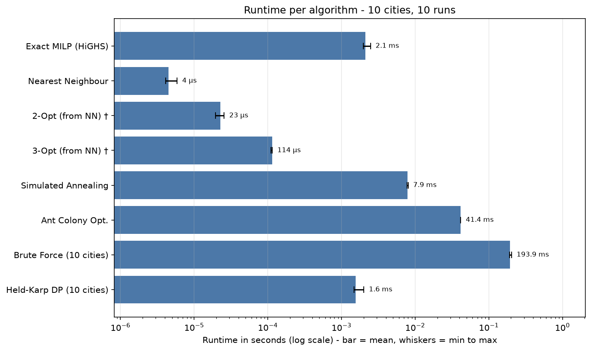
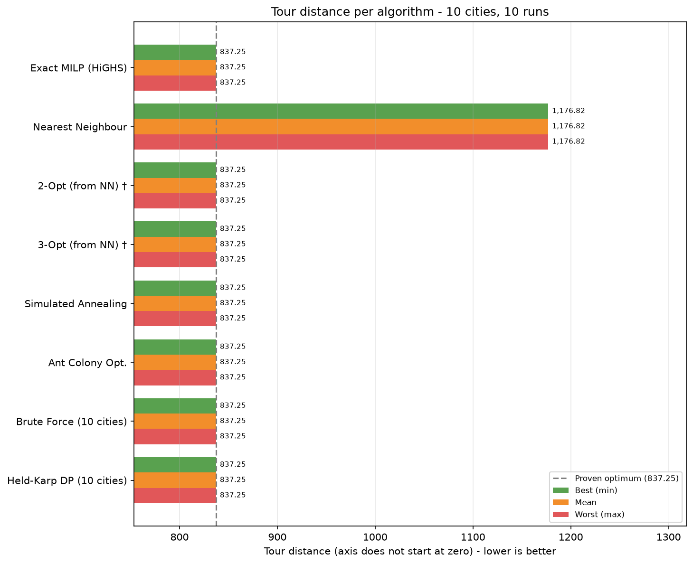

# TSP Benchmark Results: Cartesian coordinates (10 Cities) - coordinates_10_cities.xlsx

- **Cities Evaluated:** 10 (London, Bristol, Birmingham, Manchester, Liverpool, Leeds, Sheffield, Nottingham, Cardiff, Oxford)
- **Timestamp:** 2026-11-11 21:10:07
- **Runs per algorithm:** 10 (plus 1 untimed warm-up run each)
- **Base seed:** 42 (Simulated Annealing / Ant Colony run *i* uses seed + *i*)
- **Simulated Annealing parameters:** t_init=393.16, alpha=0.999137, max_iter=8,000 (scaled to n = 10)

## Performance & Quality Summary

Distance and gap are from the **best run**; time is the **mean** over all runs.

| Algorithm | Distance (best run) | Mean Time (s) | Gap vs Opt | Route Summary |
| --- | --- | --- | --- | --- |
| Exact MILP (HiGHS) | 837.25 | 0.002110 | 0.00% (proven) | London -> Leeds -> Birmingham -> ... -> Bristol -> Oxford -> London |
| Nearest Neighbour | 1,176.82 | 0.000004 | +40.56% | London -> Leeds -> Birmingham -> ... -> Oxford -> Cardiff -> London |
| 2-Opt (from NN) † | 837.25 | 0.000023 | +0.00% | London -> Leeds -> Birmingham -> ... -> Bristol -> Oxford -> London |
| 3-Opt (from NN) † | 837.25 | 0.000114 | +0.00% | London -> Leeds -> Birmingham -> ... -> Bristol -> Oxford -> London |
| Simulated Annealing | 837.25 | 0.007907 | +0.00% | London -> Leeds -> Birmingham -> ... -> Bristol -> Oxford -> London |
| Ant Colony Opt. | 837.25 | 0.041392 | +0.00% | London -> Leeds -> Birmingham -> ... -> Bristol -> Oxford -> London |
| Brute Force (10 cities) | 837.25 | 0.193882 | +0.00% | London -> Leeds -> Birmingham -> ... -> Bristol -> Oxford -> London |
| Held-Karp DP (10 cities) | 837.25 | 0.001566 | +0.00% | London -> Oxford -> Bristol -> ... -> Birmingham -> Leeds -> London |

† Time includes building the Nearest Neighbour starting tour (2-Opt and 3-Opt cannot run without it), i.e. NN time + refinement time.

## Runtime Statistics (All Algorithms)

| Algorithm | Min (s) | Mean (s) | Max (s) | SD (s) |
| --- | --- | --- | --- | --- |
| Exact MILP (HiGHS) | 0.001987 | 0.002110 | 0.002480 | 0.000159 |
| Nearest Neighbour | 0.000004 | 0.000004 | 0.000006 | 0.000001 |
| 2-Opt (from NN) † | 0.000020 | 0.000023 | 0.000026 | 0.000002 |
| 3-Opt (from NN) † | 0.000111 | 0.000114 | 0.000115 | 0.000001 |
| Simulated Annealing | 0.007806 | 0.007907 | 0.008028 | 0.000063 |
| Ant Colony Opt. | 0.041205 | 0.041392 | 0.041577 | 0.000115 |
| Brute Force (10 cities) | 0.192262 | 0.193882 | 0.203483 | 0.003401 |
| Held-Karp DP (10 cities) | 0.001481 | 0.001566 | 0.002011 | 0.000158 |

† Time includes building the Nearest Neighbour starting tour (2-Opt and 3-Opt cannot run without it), i.e. NN time + refinement time.

## Distance Statistics (Non-Deterministic Algorithms)

Final tour distance over 10 runs, each with a different seed. *Optimum Hit Rate* is the number of runs that reached the proven optimum (N/A when the exact solver was skipped).

| Algorithm | Min | Mean | Max | SD | Mean Gap vs Opt | Optimum Hit Rate |
| --- | --- | --- | --- | --- | --- | --- |
| Simulated Annealing | 837.25 | 837.25 | 837.25 | 0.00 | +0.00% | 10/10 |
| Ant Colony Opt. | 837.25 | 837.25 | 837.25 | 0.00 | +0.00% | 10/10 |

## Charts

### Runtime per Algorithm

### Tour Distance per Algorithm (Best / Mean / Worst)

Deterministic algorithms return the same tour every run, so their best, mean and worst bars are identical.

† Time includes building the Nearest Neighbour starting tour (2-Opt and 3-Opt cannot run without it), i.e. NN time + refinement time.

## Full Tour Itineraries

### Exact MILP (HiGHS)
- **Final Distance:** 837.25
- **Runtime:** 0.002110 ± 0.000159 seconds (mean ± SD over 10 runs; min 0.001987, max 0.002480)
- **Full Tour Itinerary:**
  `London -> Leeds -> Birmingham -> Manchester -> Cardiff -> Sheffield -> Nottingham -> Liverpool -> Bristol -> Oxford -> London`

### Nearest Neighbour
- **Final Distance:** 1,176.82
- **Runtime:** 0.000004 ± 0.000001 seconds (mean ± SD over 10 runs; min 0.000004, max 0.000006)
- **Full Tour Itinerary:**
  `London -> Leeds -> Birmingham -> Manchester -> Sheffield -> Nottingham -> Liverpool -> Bristol -> Oxford -> Cardiff -> London`

### 2-Opt (from NN) †
- **Final Distance:** 837.25
- **Runtime:** 0.000023 ± 0.000002 seconds (mean ± SD over 10 runs; min 0.000020, max 0.000026)
- **Full Tour Itinerary:**
  `London -> Leeds -> Birmingham -> Manchester -> Cardiff -> Sheffield -> Nottingham -> Liverpool -> Bristol -> Oxford -> London`

### 3-Opt (from NN) †
- **Final Distance:** 837.25
- **Runtime:** 0.000114 ± 0.000001 seconds (mean ± SD over 10 runs; min 0.000111, max 0.000115)
- **Full Tour Itinerary:**
  `London -> Leeds -> Birmingham -> Manchester -> Cardiff -> Sheffield -> Nottingham -> Liverpool -> Bristol -> Oxford -> London`

### Simulated Annealing
- **Final Distance (best run):** 837.25
- **Runtime:** 0.007907 ± 0.000063 seconds (mean ± SD over 10 runs; min 0.007806, max 0.008028)
- **Distance over 10 runs:** min 837.25 / mean 837.25 / max 837.25 (SD 0.00)
- **Full Tour Itinerary (best run):**
  `London -> Leeds -> Birmingham -> Manchester -> Cardiff -> Sheffield -> Nottingham -> Liverpool -> Bristol -> Oxford -> London`

### Ant Colony Opt.
- **Final Distance (best run):** 837.25
- **Runtime:** 0.041392 ± 0.000115 seconds (mean ± SD over 10 runs; min 0.041205, max 0.041577)
- **Distance over 10 runs:** min 837.25 / mean 837.25 / max 837.25 (SD 0.00)
- **Full Tour Itinerary (best run):**
  `London -> Leeds -> Birmingham -> Manchester -> Cardiff -> Sheffield -> Nottingham -> Liverpool -> Bristol -> Oxford -> London`

### Brute Force (10 cities)
- **Final Distance:** 837.25
- **Runtime:** 0.193882 ± 0.003401 seconds (mean ± SD over 10 runs; min 0.192262, max 0.203483)
- **Full Tour Itinerary:**
  `London -> Leeds -> Birmingham -> Manchester -> Cardiff -> Sheffield -> Nottingham -> Liverpool -> Bristol -> Oxford -> London`

### Held-Karp DP (10 cities)
- **Final Distance:** 837.25
- **Runtime:** 0.001566 ± 0.000158 seconds (mean ± SD over 10 runs; min 0.001481, max 0.002011)
- **Full Tour Itinerary:**
  `London -> Oxford -> Bristol -> Liverpool -> Nottingham -> Sheffield -> Cardiff -> Manchester -> Birmingham -> Leeds -> London`

## Method Notes
- **Exact MILP (HiGHS):** Proves global optimum via DFJ subtour-elimination constraints (`scipy.optimize.milp`).
- **Nearest Neighbour:** Greedy heuristic choosing closest unvisited city ($O(n^2)$).
- **2-Opt & 3-Opt:** Iterative edge-swap local search refining the Nearest Neighbour route. Their runtimes include building that route.
- **Simulated Annealing & Ant Colony:** Stochastic metaheuristics for escaping local optima. Simulated Annealing iterations scale as max(8000, 50·n²) with a data-calibrated start temperature.
- **Dynamic Programming (Held-Karp):** Computes exact global optimum via Bellman-Held-Karp subproblem memoization ($O(n^2 2^n)$).
- **Brute Force:** Evaluates all $(n - 1)!$ permutations.
- **Deterministic algorithms** (everything except Simulated Annealing and Ant Colony) return the same tour every run; only their runtime varies.
- **Warm-up:** each algorithm is run once before timing starts and that run is discarded, so one-off start-up costs do not skew the statistics.
