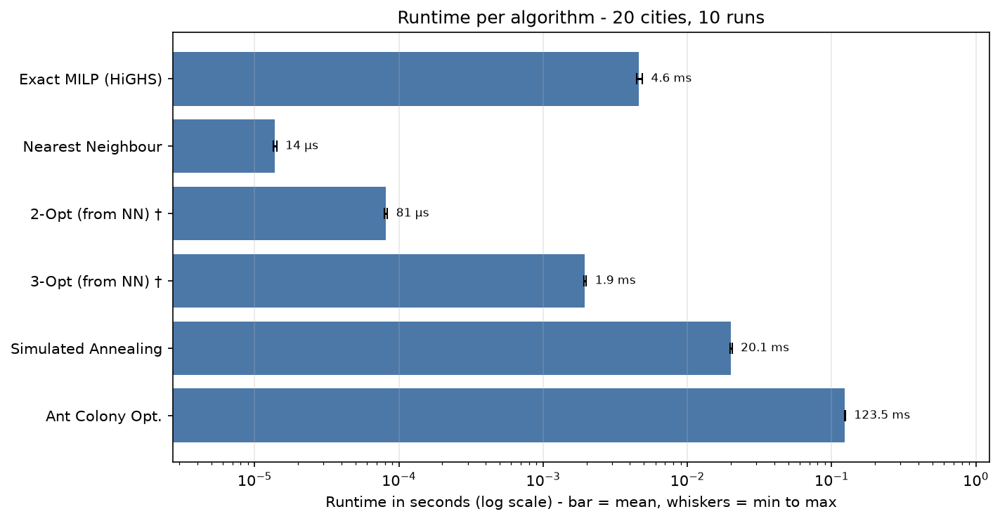
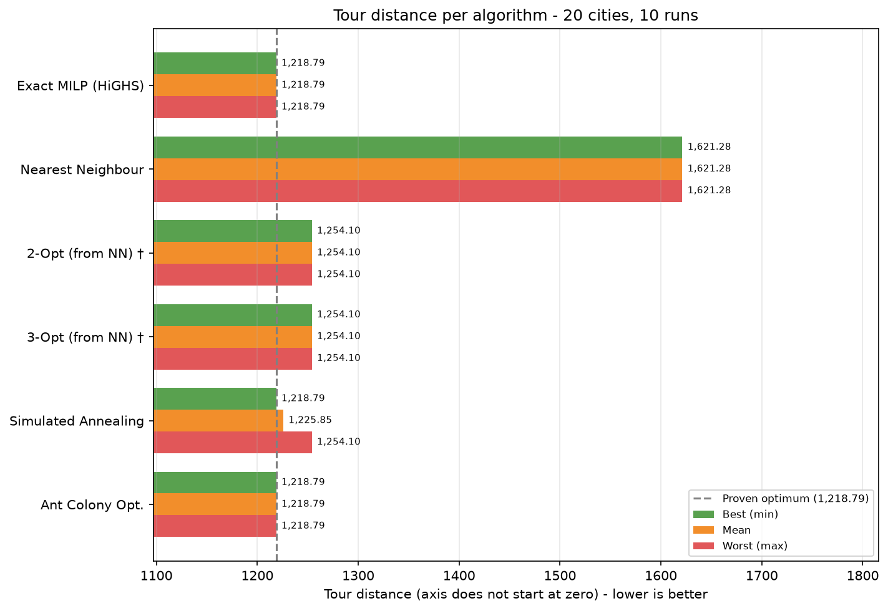

# TSP Benchmark Results: Cartesian coordinates (20 Cities) - coordinates_20_cities.xlsx

- **Cities Evaluated:** 20 (London, Bristol, Birmingham, Manchester, Liverpool, Leeds, Sheffield, Nottingham, Cardiff, Oxford, Cambridge, York, Newcastle, Leicester, Southampton, Plymouth, Brighton, Norwich, Coventry, Exeter)
- **Timestamp:** 2026-11-10 22:14:01
- **Runs per algorithm:** 10 (plus 1 untimed warm-up run each)
- **Base seed:** 42 (Simulated Annealing / Ant Colony run *i* uses seed + *i*)
- **Simulated Annealing parameters:** t_init=302.46, alpha=0.999655, max_iter=20,000 (scaled to n = 20)

## Performance & Quality Summary

Distance and gap are from the **best run**; time is the **mean** over all runs.

| Algorithm | Distance (best run) | Mean Time (s) | Gap vs Opt | Route Summary |
| --- | --- | --- | --- | --- |
| Exact MILP (HiGHS) | 1,218.79 | 0.004597 | 0.00% (proven) | London -> Newcastle -> Exeter -> ... -> Leeds -> Norwich -> London |
| Nearest Neighbour | 1,621.28 | 0.000014 | +33.02% | London -> Newcastle -> Exeter -> ... -> Southampton -> Cardiff -> London |
| 2-Opt (from NN) † | 1,254.10 | 0.000081 | +2.90% | London -> Newcastle -> Exeter -> ... -> Norwich -> Leeds -> London |
| 3-Opt (from NN) † | 1,254.10 | 0.001940 | +2.90% | London -> Newcastle -> Exeter -> ... -> Norwich -> Leeds -> London |
| Simulated Annealing | 1,218.79 | 0.020130 | +0.00% | London -> Newcastle -> Exeter -> ... -> Leeds -> Norwich -> London |
| Ant Colony Opt. | 1,218.79 | 0.123457 | +0.00% | London -> Newcastle -> Exeter -> ... -> Leeds -> Norwich -> London |

† Time includes building the Nearest Neighbour starting tour (2-Opt and 3-Opt cannot run without it), i.e. NN time + refinement time.

## Runtime Statistics (All Algorithms)

| Algorithm | Min (s) | Mean (s) | Max (s) | SD (s) |
| --- | --- | --- | --- | --- |
| Exact MILP (HiGHS) | 0.004433 | 0.004597 | 0.004867 | 0.000130 |
| Nearest Neighbour | 0.000014 | 0.000014 | 0.000014 | 0.000000 |
| 2-Opt (from NN) † | 0.000079 | 0.000081 | 0.000083 | 0.000001 |
| 3-Opt (from NN) † | 0.001916 | 0.001940 | 0.001993 | 0.000021 |
| Simulated Annealing | 0.019829 | 0.020130 | 0.020394 | 0.000190 |
| Ant Colony Opt. | 0.122620 | 0.123457 | 0.124353 | 0.000576 |

† Time includes building the Nearest Neighbour starting tour (2-Opt and 3-Opt cannot run without it), i.e. NN time + refinement time.

## Distance Statistics (Non-Deterministic Algorithms)

Final tour distance over 10 runs, each with a different seed. *Optimum Hit Rate* is the number of runs that reached the proven optimum (N/A when the exact solver was skipped).

| Algorithm | Min | Mean | Max | SD | Mean Gap vs Opt | Optimum Hit Rate |
| --- | --- | --- | --- | --- | --- | --- |
| Simulated Annealing | 1,218.79 | 1,225.85 | 1,254.10 | 14.89 | +0.58% | 8/10 |
| Ant Colony Opt. | 1,218.79 | 1,218.79 | 1,218.79 | 0.00 | +0.00% | 10/10 |

## Charts

### Runtime per Algorithm

### Tour Distance per Algorithm (Best / Mean / Worst)

Deterministic algorithms return the same tour every run, so their best, mean and worst bars are identical.

† Time includes building the Nearest Neighbour starting tour (2-Opt and 3-Opt cannot run without it), i.e. NN time + refinement time.

## Exact Scalability Projections for this Dataset

Because this dataset has **20 cities**, exhaustive exact methods grow factorially / exponentially:

| Exact Method | Theoretical Operations / States | Estimated Runtime on this Machine | Status |
| --- | --- | --- | --- |
| **Pure Brute Force** | $(n-1)! = 121,645,100,408,832,000$ permutations | **3,854.7 years** | Infeasible for real-time run |
| **Branch and Bound** | $O(c^n)$ pruned branch states | **2.3 hours** | Exponential worst-case |
| **HiGHS MILP Solver** | Dynamic DFJ subtour cuts | **0.0046 seconds** (actual, mean of 10 runs) | Solved to global optimum |

> [!NOTE]
> Estimates are calibrated against your CPU's measured throughput (~1,000,000 permutations/second).

## Full Tour Itineraries

### Exact MILP (HiGHS)
- **Final Distance:** 1,218.79
- **Runtime:** 0.004597 ± 0.000130 seconds (mean ± SD over 10 runs; min 0.004433, max 0.004867)
- **Full Tour Itinerary:**
  `London -> Newcastle -> Exeter -> Oxford -> Southampton -> Bristol -> York -> Liverpool -> Brighton -> Nottingham -> Sheffield -> Plymouth -> Cardiff -> Manchester -> Birmingham -> Cambridge -> Coventry -> Leicester -> Leeds -> Norwich -> London`

### Nearest Neighbour
- **Final Distance:** 1,621.28
- **Runtime:** 0.000014 ± 0.000000 seconds (mean ± SD over 10 runs; min 0.000014, max 0.000014)
- **Full Tour Itinerary:**
  `London -> Newcastle -> Exeter -> Oxford -> Leeds -> Norwich -> Birmingham -> Cambridge -> Coventry -> Leicester -> Manchester -> Sheffield -> Plymouth -> Nottingham -> Brighton -> Liverpool -> York -> Bristol -> Southampton -> Cardiff -> London`

### 2-Opt (from NN) †
- **Final Distance:** 1,254.10
- **Runtime:** 0.000081 ± 0.000001 seconds (mean ± SD over 10 runs; min 0.000079, max 0.000083)
- **Full Tour Itinerary:**
  `London -> Newcastle -> Exeter -> Oxford -> Southampton -> Bristol -> York -> Liverpool -> Brighton -> Nottingham -> Plymouth -> Sheffield -> Manchester -> Cardiff -> Cambridge -> Coventry -> Leicester -> Birmingham -> Norwich -> Leeds -> London`

### 3-Opt (from NN) †
- **Final Distance:** 1,254.10
- **Runtime:** 0.001940 ± 0.000021 seconds (mean ± SD over 10 runs; min 0.001916, max 0.001993)
- **Full Tour Itinerary:**
  `London -> Newcastle -> Exeter -> Oxford -> Southampton -> Bristol -> York -> Liverpool -> Brighton -> Nottingham -> Plymouth -> Sheffield -> Manchester -> Cardiff -> Cambridge -> Coventry -> Leicester -> Birmingham -> Norwich -> Leeds -> London`

### Simulated Annealing
- **Final Distance (best run):** 1,218.79
- **Runtime:** 0.020130 ± 0.000190 seconds (mean ± SD over 10 runs; min 0.019829, max 0.020394)
- **Distance over 10 runs:** min 1,218.79 / mean 1,225.85 / max 1,254.10 (SD 14.89)
- **Full Tour Itinerary (best run):**
  `London -> Newcastle -> Exeter -> Oxford -> Southampton -> Bristol -> York -> Liverpool -> Brighton -> Nottingham -> Sheffield -> Plymouth -> Cardiff -> Manchester -> Birmingham -> Cambridge -> Coventry -> Leicester -> Leeds -> Norwich -> London`

### Ant Colony Opt.
- **Final Distance (best run):** 1,218.79
- **Runtime:** 0.123457 ± 0.000576 seconds (mean ± SD over 10 runs; min 0.122620, max 0.124353)
- **Distance over 10 runs:** min 1,218.79 / mean 1,218.79 / max 1,218.79 (SD 0.00)
- **Full Tour Itinerary (best run):**
  `London -> Newcastle -> Exeter -> Oxford -> Southampton -> Bristol -> York -> Liverpool -> Brighton -> Nottingham -> Sheffield -> Plymouth -> Cardiff -> Manchester -> Birmingham -> Cambridge -> Coventry -> Leicester -> Leeds -> Norwich -> London`

## Method Notes
- **Exact MILP (HiGHS):** Proves global optimum via DFJ subtour-elimination constraints (`scipy.optimize.milp`).
- **Nearest Neighbour:** Greedy heuristic choosing closest unvisited city ($O(n^2)$).
- **2-Opt & 3-Opt:** Iterative edge-swap local search refining the Nearest Neighbour route. Their runtimes include building that route.
- **Simulated Annealing & Ant Colony:** Stochastic metaheuristics for escaping local optima. Simulated Annealing iterations scale as max(8000, 50·n²) with a data-calibrated start temperature.
- **Branch & Bound:** Prunes partial tours as soon as cumulative cost exceeds known upper bound.
- **Brute Force:** Evaluates all $(n - 1)!$ permutations.
- **Deterministic algorithms** (everything except Simulated Annealing and Ant Colony) return the same tour every run; only their runtime varies.
- **Warm-up:** each algorithm is run once before timing starts and that run is discarded, so one-off start-up costs do not skew the statistics.
