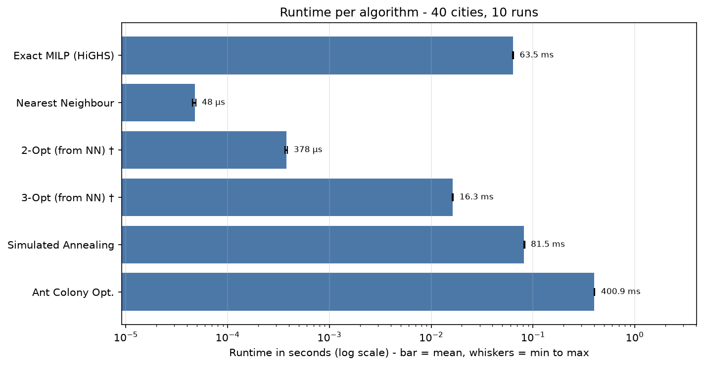
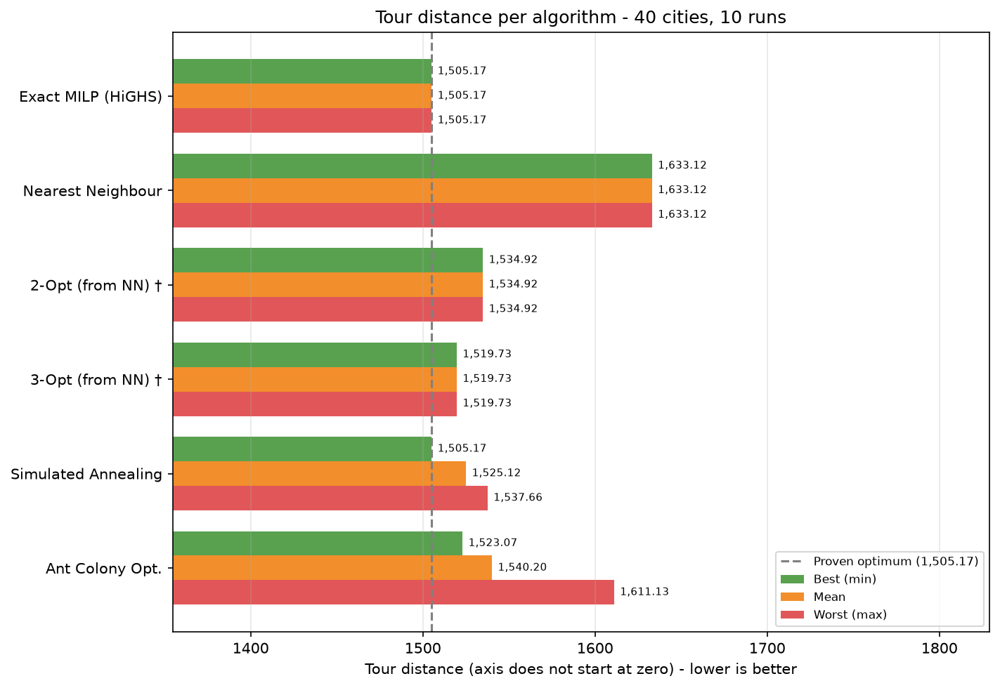

# TSP Benchmark Results: Cartesian coordinates (40 Cities) - coordinates_40_cities.xlsx

- **Cities Evaluated:** 40 (London, Bristol, Birmingham, Manchester, Liverpool, Leeds, Sheffield, Nottingham, Cardiff, Oxford, Cambridge, York, Newcastle, Leicester, Southampton, Plymouth, Brighton, Norwich, Coventry, Exeter, Bath, Bournemouth, Portsmouth, Reading, Swindon, Gloucester, Worcester, Hereford, Salisbury, Winchester, Canterbury, Dover, Ipswich, Colchester, Chelmsford, Peterborough, Lincoln, Durham, Sunderland, Middlesbrough)
- **Timestamp:** 2026-11-11 21:10:15
- **Runs per algorithm:** 10 (plus 1 untimed warm-up run each)
- **Base seed:** 42 (Simulated Annealing / Ant Colony run *i* uses seed + *i*)
- **Simulated Annealing parameters:** t_init=425.61, alpha=0.999914, max_iter=80,000 (scaled to n = 40)

## Performance & Quality Summary

Distance and gap are from the **best run**; time is the **mean** over all runs.

| Algorithm | Distance (best run) | Mean Time (s) | Gap vs Opt | Route Summary |
| --- | --- | --- | --- | --- |
| Exact MILP (HiGHS) | 1,505.17 | 0.063544 | 0.00% (proven) | London -> Newcastle -> Exeter -> ... -> Gloucester -> Norwich -> London |
| Nearest Neighbour | 1,633.12 | 0.000048 | +8.50% | London -> Newcastle -> Peterborough -> ... -> Canterbury -> Birmingham -> London |
| 2-Opt (from NN) † | 1,534.92 | 0.000378 | +1.98% | London -> Newcastle -> Peterborough -> ... -> Norwich -> Gloucester -> London |
| 3-Opt (from NN) † | 1,519.73 | 0.016349 | +0.97% | London -> Peterborough -> Bath -> ... -> Salisbury -> Canterbury -> London |
| Simulated Annealing | 1,505.17 | 0.081492 | +0.00% | London -> Norwich -> Gloucester -> ... -> Exeter -> Newcastle -> London |
| Ant Colony Opt. | 1,523.07 | 0.400946 | +1.19% | London -> Peterborough -> Bath -> ... -> Norwich -> Gloucester -> London |

† Time includes building the Nearest Neighbour starting tour (2-Opt and 3-Opt cannot run without it), i.e. NN time + refinement time.

## Runtime Statistics (All Algorithms)

| Algorithm | Min (s) | Mean (s) | Max (s) | SD (s) |
| --- | --- | --- | --- | --- |
| Exact MILP (HiGHS) | 0.063278 | 0.063544 | 0.064320 | 0.000314 |
| Nearest Neighbour | 0.000045 | 0.000048 | 0.000049 | 0.000001 |
| 2-Opt (from NN) † | 0.000367 | 0.000378 | 0.000388 | 0.000009 |
| 3-Opt (from NN) † | 0.016145 | 0.016349 | 0.016492 | 0.000114 |
| Simulated Annealing | 0.081175 | 0.081492 | 0.082920 | 0.000527 |
| Ant Colony Opt. | 0.399003 | 0.400946 | 0.405157 | 0.001809 |

† Time includes building the Nearest Neighbour starting tour (2-Opt and 3-Opt cannot run without it), i.e. NN time + refinement time.

## Distance Statistics (Non-Deterministic Algorithms)

Final tour distance over 10 runs, each with a different seed. *Optimum Hit Rate* is the number of runs that reached the proven optimum (N/A when the exact solver was skipped).

| Algorithm | Min | Mean | Max | SD | Mean Gap vs Opt | Optimum Hit Rate |
| --- | --- | --- | --- | --- | --- | --- |
| Simulated Annealing | 1,505.17 | 1,525.12 | 1,537.66 | 14.67 | +1.33% | 3/10 |
| Ant Colony Opt. | 1,523.07 | 1,540.20 | 1,611.13 | 26.76 | +2.33% | 0/10 |

## Charts

### Runtime per Algorithm

### Tour Distance per Algorithm (Best / Mean / Worst)

Deterministic algorithms return the same tour every run, so their best, mean and worst bars are identical.

† Time includes building the Nearest Neighbour starting tour (2-Opt and 3-Opt cannot run without it), i.e. NN time + refinement time.

## Exact Scalability Projections for this Dataset

Because this dataset has **40 cities**, exhaustive exact methods grow factorially / exponentially:

| Exact Method | Theoretical Operations / States | Estimated Runtime on this Machine | Status |
| --- | --- | --- | --- |
| **Pure Brute Force** | $(n-1)! = 20,397,882,081,197,443,358,640,281,739,902,897,356,800,000,000$ permutations | **646,369,878,609,192,260,993,024.00 billion years** | Infeasible for real-time run |
| **Held-Karp DP** | $O(n^2 2^n) \approx 1,759,218,604,441,600$ operations | **27.9 years** | Exponential compute / memory limit |
| **HiGHS MILP Solver** | Dynamic DFJ subtour cuts | **0.0635 seconds** (actual, mean of 10 runs) | Solved to global optimum |

> [!NOTE]
> Estimates are calibrated against your CPU's measured throughput (~1,000,000 permutations/second).

## Full Tour Itineraries

### Exact MILP (HiGHS)
- **Final Distance:** 1,505.17
- **Runtime:** 0.063544 ± 0.000314 seconds (mean ± SD over 10 runs; min 0.063278, max 0.064320)
- **Full Tour Itinerary:**
  `London -> Newcastle -> Exeter -> Oxford -> Salisbury -> Canterbury -> Leeds -> Hereford -> Leicester -> Chelmsford -> Coventry -> Portsmouth -> Colchester -> Sunderland -> Worcester -> Bournemouth -> Cambridge -> Durham -> Cardiff -> Middlesbrough -> Winchester -> Manchester -> Sheffield -> Plymouth -> Nottingham -> Brighton -> Ipswich -> Liverpool -> Dover -> Lincoln -> Swindon -> York -> Southampton -> Bristol -> Peterborough -> Bath -> Reading -> Birmingham -> Gloucester -> Norwich -> London`

### Nearest Neighbour
- **Final Distance:** 1,633.12
- **Runtime:** 0.000048 ± 0.000001 seconds (mean ± SD over 10 runs; min 0.000045, max 0.000049)
- **Full Tour Itinerary:**
  `London -> Newcastle -> Peterborough -> Bath -> Reading -> Gloucester -> Norwich -> Leeds -> Hereford -> Leicester -> Chelmsford -> Coventry -> Portsmouth -> Colchester -> Sunderland -> Worcester -> Bournemouth -> Cambridge -> Durham -> Winchester -> Middlesbrough -> Cardiff -> Manchester -> Sheffield -> Plymouth -> Nottingham -> Brighton -> Ipswich -> Liverpool -> Dover -> Lincoln -> Swindon -> York -> Bristol -> Southampton -> Exeter -> Oxford -> Salisbury -> Canterbury -> Birmingham -> London`

### 2-Opt (from NN) †
- **Final Distance:** 1,534.92
- **Runtime:** 0.000378 ± 0.000009 seconds (mean ± SD over 10 runs; min 0.000367, max 0.000388)
- **Full Tour Itinerary:**
  `London -> Newcastle -> Peterborough -> Bath -> Reading -> Birmingham -> Leicester -> Hereford -> Coventry -> Chelmsford -> Portsmouth -> Colchester -> Sunderland -> Worcester -> Bournemouth -> Cambridge -> Durham -> Cardiff -> Middlesbrough -> Winchester -> Manchester -> Sheffield -> Plymouth -> Nottingham -> Brighton -> Ipswich -> Liverpool -> Dover -> Lincoln -> Swindon -> York -> Bristol -> Southampton -> Exeter -> Oxford -> Salisbury -> Canterbury -> Leeds -> Norwich -> Gloucester -> London`

### 3-Opt (from NN) †
- **Final Distance:** 1,519.73
- **Runtime:** 0.016349 ± 0.000114 seconds (mean ± SD over 10 runs; min 0.016145, max 0.016492)
- **Full Tour Itinerary:**
  `London -> Peterborough -> Bath -> Reading -> Birmingham -> Gloucester -> Norwich -> Leeds -> Hereford -> Leicester -> Chelmsford -> Coventry -> Portsmouth -> Colchester -> Sunderland -> Worcester -> Bournemouth -> Cambridge -> Durham -> Cardiff -> Middlesbrough -> Winchester -> Manchester -> Sheffield -> Plymouth -> Nottingham -> Brighton -> Ipswich -> Liverpool -> Dover -> Lincoln -> Swindon -> York -> Bristol -> Southampton -> Newcastle -> Exeter -> Oxford -> Salisbury -> Canterbury -> London`

### Simulated Annealing
- **Final Distance (best run):** 1,505.17
- **Runtime:** 0.081492 ± 0.000527 seconds (mean ± SD over 10 runs; min 0.081175, max 0.082920)
- **Distance over 10 runs:** min 1,505.17 / mean 1,525.12 / max 1,537.66 (SD 14.67)
- **Full Tour Itinerary (best run):**
  `London -> Norwich -> Gloucester -> Birmingham -> Reading -> Bath -> Peterborough -> Bristol -> Southampton -> York -> Swindon -> Lincoln -> Dover -> Liverpool -> Ipswich -> Brighton -> Nottingham -> Plymouth -> Sheffield -> Manchester -> Winchester -> Middlesbrough -> Cardiff -> Durham -> Cambridge -> Bournemouth -> Worcester -> Sunderland -> Colchester -> Portsmouth -> Coventry -> Chelmsford -> Leicester -> Hereford -> Leeds -> Canterbury -> Salisbury -> Oxford -> Exeter -> Newcastle -> London`

### Ant Colony Opt.
- **Final Distance (best run):** 1,523.07
- **Runtime:** 0.400946 ± 0.001809 seconds (mean ± SD over 10 runs; min 0.399003, max 0.405157)
- **Distance over 10 runs:** min 1,523.07 / mean 1,540.20 / max 1,611.13 (SD 26.76)
- **Full Tour Itinerary (best run):**
  `London -> Peterborough -> Bath -> Reading -> Birmingham -> Hereford -> Leicester -> Chelmsford -> Coventry -> Portsmouth -> Colchester -> Sunderland -> Worcester -> Bournemouth -> Cambridge -> Durham -> Cardiff -> Middlesbrough -> Winchester -> Manchester -> Sheffield -> Plymouth -> Nottingham -> Brighton -> Ipswich -> Liverpool -> Dover -> Lincoln -> Swindon -> York -> Bristol -> Southampton -> Newcastle -> Exeter -> Oxford -> Salisbury -> Canterbury -> Leeds -> Norwich -> Gloucester -> London`

## Method Notes
- **Exact MILP (HiGHS):** Proves global optimum via DFJ subtour-elimination constraints (`scipy.optimize.milp`).
- **Nearest Neighbour:** Greedy heuristic choosing closest unvisited city ($O(n^2)$).
- **2-Opt & 3-Opt:** Iterative edge-swap local search refining the Nearest Neighbour route. Their runtimes include building that route.
- **Simulated Annealing & Ant Colony:** Stochastic metaheuristics for escaping local optima. Simulated Annealing iterations scale as max(8000, 50·n²) with a data-calibrated start temperature.
- **Dynamic Programming (Held-Karp):** Computes exact global optimum via Bellman-Held-Karp subproblem memoization ($O(n^2 2^n)$).
- **Brute Force:** Evaluates all $(n - 1)!$ permutations.
- **Deterministic algorithms** (everything except Simulated Annealing and Ant Colony) return the same tour every run; only their runtime varies.
- **Warm-up:** each algorithm is run once before timing starts and that run is discarded, so one-off start-up costs do not skew the statistics.
