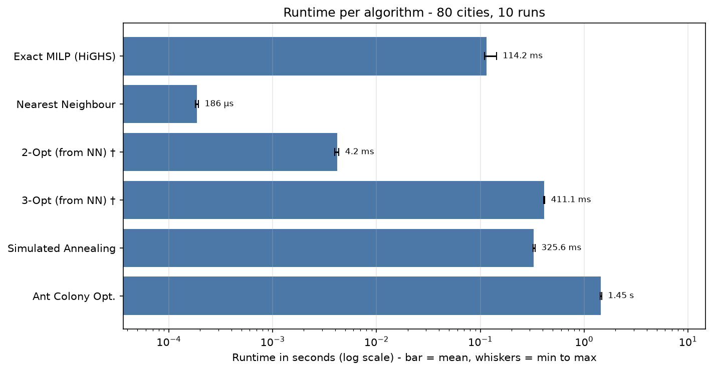
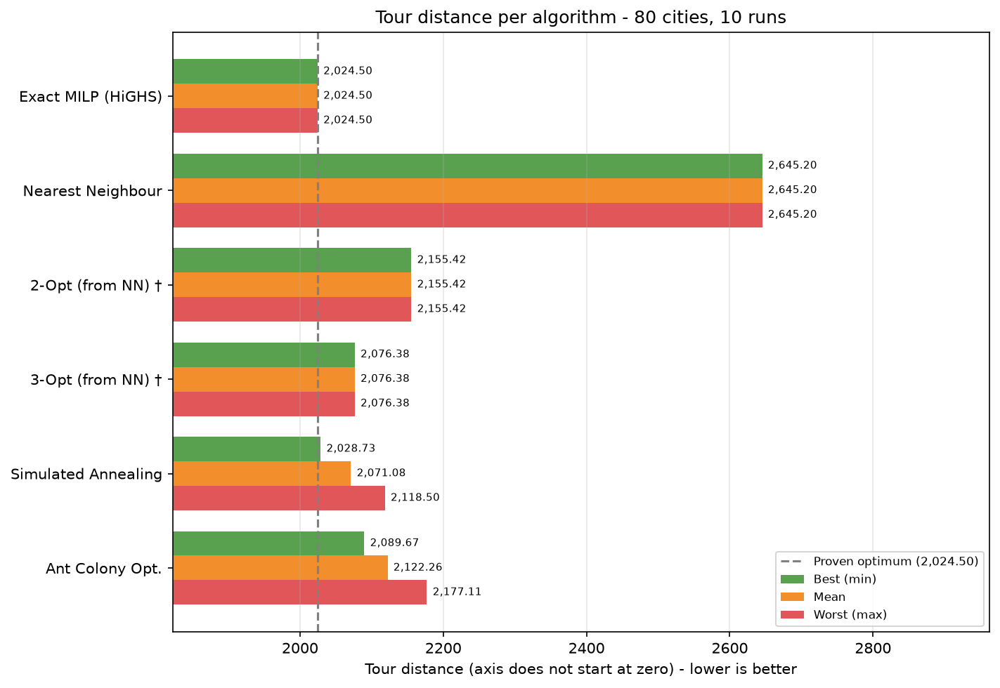

# TSP Benchmark Results: Cartesian coordinates (80 Cities) - coordinates_80_cities.xlsx

- **Cities Evaluated:** 80 (London, Bristol, Birmingham, Manchester, Liverpool, Leeds, Sheffield, Nottingham, Cardiff, Oxford, Cambridge, York, Newcastle, Leicester, Southampton, Plymouth, Brighton, Norwich, Coventry, Exeter, Bath, Bournemouth, Portsmouth, Reading, Swindon, Gloucester, Worcester, Hereford, Salisbury, Winchester, Canterbury, Dover, Ipswich, Colchester, Chelmsford, Peterborough, Lincoln, Durham, Sunderland, Middlesbrough, Blackpool, Bolton, Stockport, Chester, Shrewsbury, Telford, Milton Keynes, Luton, Watford, St Albans, Guildford, Maidstone, Crawley, Chichester, Taunton, Torquay, Barnstaple, Carlisle, Lancaster, Preston, Bradford, Hull, Stoke, Wolverhampton, Derby, Northampton, Harrogate, Scarborough, Grimsby, Doncaster, Wakefield, Huddersfield, Swansea, Newport, Wrexham, Aberystwyth, Bangor, Kendal, Stratford, Ely)
- **Timestamp:** 2026-11-10 22:14:33
- **Runs per algorithm:** 10 (plus 1 untimed warm-up run each)
- **Base seed:** 42 (Simulated Annealing / Ant Colony run *i* uses seed + *i*)
- **Simulated Annealing parameters:** t_init=488.07, alpha=0.999978, max_iter=320,000 (scaled to n = 80)

## Performance & Quality Summary

Distance and gap are from the **best run**; time is the **mean** over all runs.

| Algorithm | Distance (best run) | Mean Time (s) | Gap vs Opt | Route Summary |
| --- | --- | --- | --- | --- |
| Exact MILP (HiGHS) | 2,024.50 | 0.114235 | 0.00% (proven) | London -> Newcastle -> Grimsby -> ... -> Norwich -> Gloucester -> London |
| Nearest Neighbour | 2,645.20 | 0.000186 | +30.66% | London -> Newcastle -> Crawley -> ... -> Plymouth -> Chichester -> London |
| 2-Opt (from NN) † | 2,155.42 | 0.004169 | +6.47% | London -> Newcastle -> Crawley -> ... -> Chester -> Peterborough -> London |
| 3-Opt (from NN) † | 2,076.38 | 0.411133 | +2.56% | London -> Newcastle -> Grimsby -> ... -> Leeds -> Lancaster -> London |
| Simulated Annealing | 2,028.73 | 0.325594 | +0.21% | London -> Gloucester -> Norwich -> ... -> Canterbury -> Grimsby -> London |
| Ant Colony Opt. | 2,089.67 | 1.450870 | +3.22% | London -> Gloucester -> Norwich -> ... -> Grimsby -> Newcastle -> London |

† Time includes building the Nearest Neighbour starting tour (2-Opt and 3-Opt cannot run without it), i.e. NN time + refinement time.

## Runtime Statistics (All Algorithms)

| Algorithm | Min (s) | Mean (s) | Max (s) | SD (s) |
| --- | --- | --- | --- | --- |
| Exact MILP (HiGHS) | 0.110074 | 0.114235 | 0.143013 | 0.010150 |
| Nearest Neighbour | 0.000182 | 0.000186 | 0.000193 | 0.000003 |
| 2-Opt (from NN) † | 0.003959 | 0.004169 | 0.004345 | 0.000142 |
| 3-Opt (from NN) † | 0.405942 | 0.411133 | 0.417358 | 0.004535 |
| Simulated Annealing | 0.321240 | 0.325594 | 0.337085 | 0.005357 |
| Ant Colony Opt. | 1.430867 | 1.450870 | 1.474877 | 0.012840 |

† Time includes building the Nearest Neighbour starting tour (2-Opt and 3-Opt cannot run without it), i.e. NN time + refinement time.

## Distance Statistics (Non-Deterministic Algorithms)

Final tour distance over 10 runs, each with a different seed. *Optimum Hit Rate* is the number of runs that reached the proven optimum (N/A when the exact solver was skipped).

| Algorithm | Min | Mean | Max | SD | Mean Gap vs Opt | Optimum Hit Rate |
| --- | --- | --- | --- | --- | --- | --- |
| Simulated Annealing | 2,028.73 | 2,071.08 | 2,118.50 | 26.33 | +2.30% | 0/10 |
| Ant Colony Opt. | 2,089.67 | 2,122.26 | 2,177.11 | 33.91 | +4.83% | 0/10 |

## Charts

### Runtime per Algorithm

### Tour Distance per Algorithm (Best / Mean / Worst)

Deterministic algorithms return the same tour every run, so their best, mean and worst bars are identical.

† Time includes building the Nearest Neighbour starting tour (2-Opt and 3-Opt cannot run without it), i.e. NN time + refinement time.

## Exact Scalability Projections for this Dataset

Because this dataset has **80 cities**, exhaustive exact methods grow factorially / exponentially:

| Exact Method | Theoretical Operations / States | Estimated Runtime on this Machine | Status |
| --- | --- | --- | --- |
| **Pure Brute Force** | $(n-1)! = 894,618,213,078,297,528,685,144,171,539,831,652,069,808,216,779,571,907,213,868,063,227,837,990,693,501,860,533,361,810,841,010,176,000,000,000,000,000,000$ permutations | **28,348,740,496,054,756,520,864,964,271,441,865,715,557,636,594,286,813,808,321,533,322,015,375,824,020,916,933,201,164,763,136.00 billion years** | Infeasible for real-time run |
| **Branch and Bound** | $O(c^n)$ pruned branch states | **175,429,206,116,508.34 billion years** | Exponential worst-case |
| **HiGHS MILP Solver** | Dynamic DFJ subtour cuts | **0.1142 seconds** (actual, mean of 10 runs) | Solved to global optimum |

> [!NOTE]
> Estimates are calibrated against your CPU's measured throughput (~1,000,000 permutations/second).

## Full Tour Itineraries

### Exact MILP (HiGHS)
- **Final Distance:** 2,024.50
- **Runtime:** 0.114235 ± 0.010150 seconds (mean ± SD over 10 runs; min 0.110074, max 0.143013)
- **Full Tour Itinerary:**
  `London -> Newcastle -> Grimsby -> Canterbury -> Huddersfield -> Salisbury -> Blackpool -> Oxford -> Maidstone -> Exeter -> Harrogate -> Crawley -> Carlisle -> Southampton -> Watford -> Bristol -> Torquay -> Chester -> Peterborough -> Bath -> Reading -> Bolton -> Swindon -> York -> Lincoln -> Dover -> Liverpool -> Ipswich -> Brighton -> Nottingham -> Milton Keynes -> Sheffield -> Stratford -> Plymouth -> Barnstaple -> Wrexham -> Wakefield -> Bradford -> Manchester -> Wolverhampton -> Guildford -> Aberystwyth -> Scarborough -> Shrewsbury -> Winchester -> Middlesbrough -> Chichester -> Cardiff -> Ely -> Doncaster -> Preston -> Newport -> Taunton -> Northampton -> Luton -> Durham -> St Albans -> Swansea -> Kendal -> Hull -> Birmingham -> Stockport -> Cambridge -> Bournemouth -> Worcester -> Sunderland -> Colchester -> Stoke -> Portsmouth -> Coventry -> Chelmsford -> Telford -> Bangor -> Leicester -> Hereford -> Derby -> Leeds -> Lancaster -> Norwich -> Gloucester -> London`

### Nearest Neighbour
- **Final Distance:** 2,645.20
- **Runtime:** 0.000186 ± 0.000003 seconds (mean ± SD over 10 runs; min 0.000182, max 0.000193)
- **Full Tour Itinerary:**
  `London -> Newcastle -> Crawley -> Harrogate -> Exeter -> Maidstone -> Oxford -> Blackpool -> Salisbury -> Huddersfield -> Canterbury -> Grimsby -> Lancaster -> Leeds -> Norwich -> Gloucester -> Reading -> Bath -> Bolton -> Peterborough -> Chester -> Torquay -> Swindon -> York -> Lincoln -> Dover -> Liverpool -> Ipswich -> Nottingham -> Brighton -> Milton Keynes -> Sheffield -> Barnstaple -> Wrexham -> Wakefield -> Bradford -> Manchester -> Wolverhampton -> Guildford -> Aberystwyth -> Scarborough -> Shrewsbury -> Winchester -> Middlesbrough -> Cardiff -> Ely -> Taunton -> Newport -> Preston -> Doncaster -> Northampton -> Luton -> Durham -> Cambridge -> Bournemouth -> Worcester -> Stockport -> Bangor -> Telford -> Chelmsford -> Coventry -> Portsmouth -> Colchester -> Sunderland -> Stoke -> Leicester -> Hereford -> Derby -> Birmingham -> Hull -> Swansea -> St Albans -> Kendal -> Bristol -> Watford -> Southampton -> Carlisle -> Stratford -> Plymouth -> Chichester -> London`

### 2-Opt (from NN) †
- **Final Distance:** 2,155.42
- **Runtime:** 0.004169 ± 0.000142 seconds (mean ± SD over 10 runs; min 0.003959, max 0.004345)
- **Full Tour Itinerary:**
  `London -> Newcastle -> Crawley -> Harrogate -> Exeter -> Maidstone -> Oxford -> Blackpool -> Salisbury -> Huddersfield -> Canterbury -> Grimsby -> Lancaster -> Leeds -> Norwich -> Gloucester -> Reading -> Bath -> Bolton -> Swindon -> York -> Lincoln -> Kendal -> Swansea -> St Albans -> Hull -> Birmingham -> Derby -> Hereford -> Leicester -> Bangor -> Telford -> Chelmsford -> Coventry -> Portsmouth -> Stoke -> Colchester -> Sunderland -> Worcester -> Bournemouth -> Stockport -> Cambridge -> Durham -> Luton -> Northampton -> Taunton -> Newport -> Preston -> Doncaster -> Ely -> Cardiff -> Middlesbrough -> Winchester -> Shrewsbury -> Scarborough -> Aberystwyth -> Guildford -> Wolverhampton -> Manchester -> Bradford -> Wakefield -> Barnstaple -> Wrexham -> Chichester -> Plymouth -> Stratford -> Sheffield -> Milton Keynes -> Nottingham -> Brighton -> Ipswich -> Liverpool -> Dover -> Watford -> Southampton -> Carlisle -> Bristol -> Torquay -> Chester -> Peterborough -> London`

### 3-Opt (from NN) †
- **Final Distance:** 2,076.38
- **Runtime:** 0.411133 ± 0.004535 seconds (mean ± SD over 10 runs; min 0.405942, max 0.417358)
- **Full Tour Itinerary:**
  `London -> Newcastle -> Grimsby -> Canterbury -> Huddersfield -> Salisbury -> Blackpool -> Oxford -> Maidstone -> Exeter -> Harrogate -> Crawley -> Carlisle -> Southampton -> Watford -> Bristol -> Torquay -> Chester -> Swindon -> York -> Lincoln -> Dover -> Liverpool -> Ipswich -> Brighton -> Nottingham -> Milton Keynes -> Sheffield -> Stratford -> Plymouth -> Barnstaple -> Wrexham -> Wakefield -> Bradford -> Manchester -> Wolverhampton -> Guildford -> Aberystwyth -> Scarborough -> Shrewsbury -> Winchester -> Middlesbrough -> Chichester -> Cardiff -> Ely -> Doncaster -> Preston -> Newport -> Taunton -> Northampton -> Luton -> Durham -> Cambridge -> Stockport -> Bournemouth -> Worcester -> Sunderland -> Colchester -> Stoke -> Portsmouth -> Coventry -> Chelmsford -> Telford -> Bangor -> Leicester -> Hereford -> Derby -> Birmingham -> Hull -> St Albans -> Swansea -> Kendal -> Bolton -> Peterborough -> Bath -> Reading -> Gloucester -> Norwich -> Leeds -> Lancaster -> London`

### Simulated Annealing
- **Final Distance (best run):** 2,028.73
- **Runtime:** 0.325594 ± 0.005357 seconds (mean ± SD over 10 runs; min 0.321240, max 0.337085)
- **Distance over 10 runs:** min 2,028.73 / mean 2,071.08 / max 2,118.50 (SD 26.33)
- **Full Tour Itinerary (best run):**
  `London -> Gloucester -> Norwich -> Lancaster -> Leeds -> Derby -> Hereford -> Leicester -> Bangor -> Telford -> Chelmsford -> Coventry -> Portsmouth -> Stoke -> Colchester -> Sunderland -> Worcester -> Bournemouth -> Stockport -> Cambridge -> Durham -> Luton -> Northampton -> Newport -> Preston -> Doncaster -> Taunton -> Ely -> Cardiff -> Chichester -> Middlesbrough -> Winchester -> Shrewsbury -> Scarborough -> Aberystwyth -> Guildford -> Wolverhampton -> Manchester -> Bradford -> Wakefield -> Wrexham -> Barnstaple -> Plymouth -> Stratford -> Sheffield -> Milton Keynes -> Nottingham -> Brighton -> Ipswich -> Liverpool -> Dover -> Lincoln -> Kendal -> Swansea -> St Albans -> Hull -> Birmingham -> Bolton -> Reading -> Bath -> Peterborough -> Chester -> Torquay -> Swindon -> York -> Bristol -> Watford -> Southampton -> Carlisle -> Crawley -> Newcastle -> Harrogate -> Exeter -> Maidstone -> Oxford -> Blackpool -> Salisbury -> Huddersfield -> Canterbury -> Grimsby -> London`

### Ant Colony Opt.
- **Final Distance (best run):** 2,089.67
- **Runtime:** 1.450870 ± 0.012840 seconds (mean ± SD over 10 runs; min 1.430867, max 1.474877)
- **Distance over 10 runs:** min 2,089.67 / mean 2,122.26 / max 2,177.11 (SD 33.91)
- **Full Tour Itinerary (best run):**
  `London -> Gloucester -> Norwich -> Lancaster -> Leeds -> Derby -> Hereford -> Leicester -> Bangor -> Telford -> Chelmsford -> Coventry -> Portsmouth -> Colchester -> Sunderland -> Stoke -> Northampton -> Luton -> Durham -> Cambridge -> Worcester -> Bournemouth -> Stockport -> Birmingham -> Hull -> Swansea -> St Albans -> Kendal -> Wakefield -> Bradford -> Manchester -> Wolverhampton -> Aberystwyth -> Guildford -> Scarborough -> Shrewsbury -> Winchester -> Doncaster -> Preston -> Newport -> Taunton -> Ely -> Cardiff -> Middlesbrough -> Chichester -> Barnstaple -> Wrexham -> Stratford -> Plymouth -> Sheffield -> Milton Keynes -> Nottingham -> Brighton -> Ipswich -> Liverpool -> Dover -> Lincoln -> York -> Swindon -> Bolton -> Reading -> Bath -> Peterborough -> Chester -> Torquay -> Bristol -> Watford -> Southampton -> Carlisle -> Crawley -> Harrogate -> Exeter -> Maidstone -> Oxford -> Blackpool -> Salisbury -> Huddersfield -> Canterbury -> Grimsby -> Newcastle -> London`

## Method Notes
- **Exact MILP (HiGHS):** Proves global optimum via DFJ subtour-elimination constraints (`scipy.optimize.milp`).
- **Nearest Neighbour:** Greedy heuristic choosing closest unvisited city ($O(n^2)$).
- **2-Opt & 3-Opt:** Iterative edge-swap local search refining the Nearest Neighbour route. Their runtimes include building that route.
- **Simulated Annealing & Ant Colony:** Stochastic metaheuristics for escaping local optima. Simulated Annealing iterations scale as max(8000, 50·n²) with a data-calibrated start temperature.
- **Branch & Bound:** Prunes partial tours as soon as cumulative cost exceeds known upper bound.
- **Brute Force:** Evaluates all $(n - 1)!$ permutations.
- **Deterministic algorithms** (everything except Simulated Annealing and Ant Colony) return the same tour every run; only their runtime varies.
- **Warm-up:** each algorithm is run once before timing starts and that run is discarded, so one-off start-up costs do not skew the statistics.
