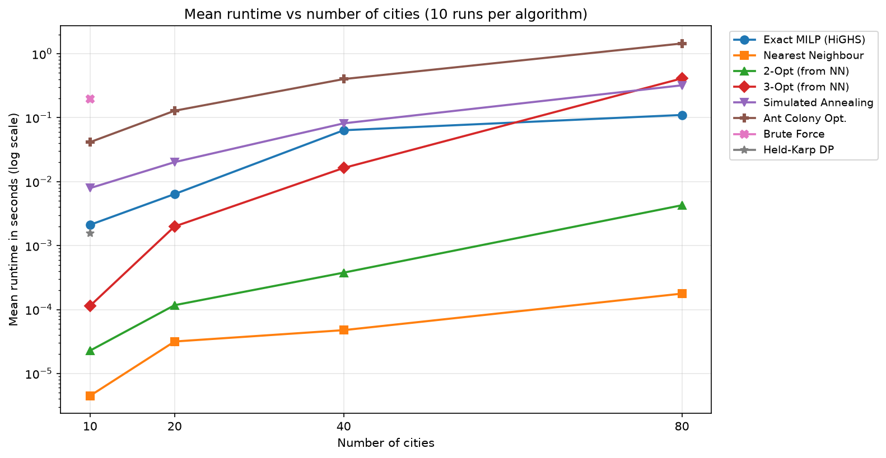
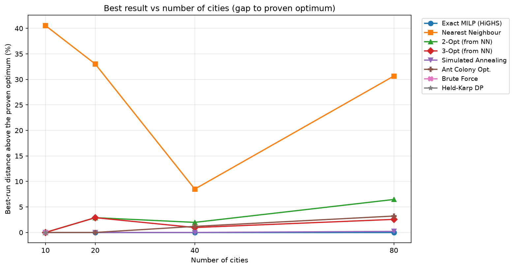

# TSP Scalability Summary

- **Timestamp:** 2026-11-11 21:10:40
- **Runs per algorithm:** 10 (plus 1 untimed warm-up run each)
- **Base seed:** 42
- **Datasets:**
  - **10 cities:** [Cartesian coordinates (10 Cities) - coordinates_10_cities.xlsx](tsp_loader_coordinates_10_cities_results.md)
  - **20 cities:** [Cartesian coordinates (20 Cities) - coordinates_20_cities.xlsx](tsp_loader_coordinates_20_cities_results.md)
  - **40 cities:** [Cartesian coordinates (40 Cities) - coordinates_40_cities.xlsx](tsp_loader_coordinates_40_cities_results.md)
  - **80 cities:** [Cartesian coordinates (80 Cities) - coordinates_80_cities.xlsx](tsp_loader_coordinates_80_cities_results.md)

## Runtime vs Number of Cities

Mean runtime in seconds (log scale). 2-Opt and 3-Opt times include building the Nearest Neighbour starting tour.

| Algorithm | 10 cities | 20 cities | 40 cities | 80 cities |
| --- | --- | --- | --- | --- |
| Exact MILP (HiGHS) | 0.002110 | 0.006389 | 0.063544 | 0.110159 |
| Nearest Neighbour | 0.000004 | 0.000032 | 0.000048 | 0.000177 |
| 2-Opt (from NN) | 0.000023 | 0.000117 | 0.000378 | 0.004270 |
| 3-Opt (from NN) | 0.000114 | 0.001989 | 0.016349 | 0.410596 |
| Simulated Annealing | 0.007907 | 0.020168 | 0.081492 | 0.320293 |
| Ant Colony Opt. | 0.041392 | 0.128119 | 0.400946 | 1.443964 |
| Brute Force | 0.193882 | - | - | - |
| Held-Karp DP | 0.001566 | - | - | - |

## Best Result vs Number of Cities

| Algorithm | 10 cities | 20 cities | 40 cities | 80 cities |
| --- | --- | --- | --- | --- |
| Exact MILP (HiGHS) | +0.00% | +0.00% | +0.00% | +0.00% |
| Nearest Neighbour | +40.56% | +33.02% | +8.50% | +30.66% |
| 2-Opt (from NN) | +0.00% | +2.90% | +1.98% | +6.47% |
| 3-Opt (from NN) | +0.00% | +2.90% | +0.97% | +2.56% |
| Simulated Annealing | +0.00% | +0.00% | +0.00% | +0.21% |
| Ant Colony Opt. | +0.00% | +0.00% | +1.19% | +3.22% |
| Brute Force | +0.00% | - | - | - |
| Held-Karp DP | +0.00% | - | - | - |

> [!NOTE]
> Raw tour distances are not comparable between datasets of different sizes, so the best result is shown as the gap (%) above the proven optimum. Brute Force and Dynamic Programming only run on the smallest dataset, so they appear as a single marker.
